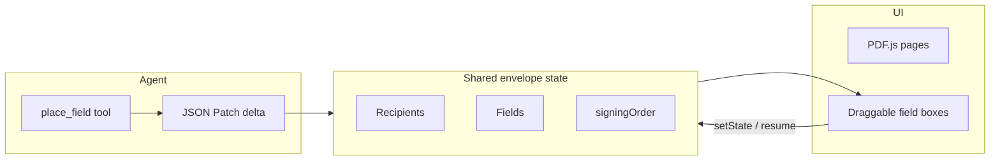

# How AG-UI works in this demo

[AG-UI](https://github.com/ag-ui-protocol/ag-ui) (Agent–User Interaction Protocol, MIT) is an event stream between an agent and a user-facing app. This demo uses the official TypeScript packages:

- `@ag-ui/core` — event and `RunAgentInput` types
- `@ag-ui/encoder` — SSE (and protobuf) framing on the server
- `@ag-ui/client` — `HttpAgent` consumes `POST` + `text/event-stream`

We do not hand-roll the wire format.

## The run

The UI POSTs a `RunAgentInput` (`threadId`, `runId`, `messages`, `state`, later `resume`) to `/agui`. The Hono server answers with one AG-UI event per SSE `data:` line.

```mermaid
sequenceDiagram
  participant User
  participant UI as Vite UI (HttpAgent)
  participant Agent as Hono AG-UI server

  User->>UI: Prepare envelope
  UI->>Agent: POST /agui RunAgentInput (run-1)
  Agent-->>UI: RUN_STARTED
  Agent-->>UI: STATE_SNAPSHOT (empty envelope)
  Agent-->>UI: TEXT_MESSAGE_* narration
  loop each field
    Agent-->>UI: TOOL_CALL_START/ARGS/END place_field
    Agent-->>UI: STATE_DELTA JSON Patch
    Agent-->>UI: TOOL_CALL_RESULT
    UI->>User: box appears on the PDF
  end
  Agent-->>UI: RUN_FINISHED outcome=interrupt + responseSchema
  UI->>User: form from schema; boxes are editable
  User->>UI: drag a box + approve
  UI->>Agent: POST /agui run-2 + resume[] + updated state
  Agent-->>UI: TEXT_MESSAGE (acknowledges the drag)
  Agent-->>UI: RUN_FINISHED outcome=success (ready to send)
```

## Event families this demo uses

| Family | Events | Role here |
| --- | --- | --- |
| Lifecycle | `RUN_STARTED`, `RUN_FINISHED`, `STEP_*` | Bracket the run; steps label inspect vs place vs approve |
| Text | `TEXT_MESSAGE_START/CONTENT/END` | Streaming narration |
| Tools | `TOOL_CALL_START/ARGS/END`, `TOOL_CALL_RESULT` | `place_field`, `set_recipients` |
| State | `STATE_SNAPSHOT`, `STATE_DELTA` | Envelope JSON (recipients, order, `fields[]`) |
| Interrupt | `RUN_FINISHED.outcome` | Pause for a typed human form |

## Shared state and JSON Patch

`STATE_SNAPSHOT` replaces the envelope wholesale (start of the run, and again at the interrupt boundary so resume does not depend on a private checkpoint).

`STATE_DELTA` is RFC 6902 JSON Patch (`fast-json-patch`), for example:

```json
{ "op": "add", "path": "/fields/-", "value": { "id": "jordan-signature", "page": 6, "bbox": { "x": 0.09, "y": 0.48, "width": 0.36, "height": 0.05 }, "confidence": 0.94 } }
```

The official client applies those patches. The PDF overlay is just a view of `agent.state.fields`. When you drag a box, the UI calls `agent.setState(...)`. The next `RunAgentInput` sends that state back, so the agent’s following step can see the correction.



## Interrupts with a response schema

AG-UI runs are not long-lived request/response with a side channel. If the agent needs a human, it **ends the run** with:

```ts
RUN_FINISHED {
  outcome: {
    type: "interrupt",
    interrupts: [{
      id: "int_confirm_envelope",
      reason: "confirmation",
      message: "Confirm recipients…",
      responseSchema: { type: "object", properties: { approved, recipients, signingOrder, reviewFields } }
    }]
  }
}
```

`HttpAgent.pendingInterrupts` holds that object. This UI **renders a form from `responseSchema`** (not a one-off hardcoded approval card). Approve starts a **new** run on the same `threadId` with:

```ts
resume: [{ interruptId: "int_confirm_envelope", status: "resolved", payload: { approved: true, ... } }]
```

That is the human-in-the-loop contract: schema on the way out, typed payload on the way back.

## What this teaches about “agent prepares, human approves”

Signing flows fail in two opposite ways: a fully automatic agent that stamps the wrong signature block, or a human who tabs through every field by hand. AG-UI makes the split **visible and reversible**:

1. The agent is allowed to be fast and slightly wrong. Mock mode *intentionally* offsets a date and puts initials on the wrong page, and it labels those with low confidence.
2. Shared state is the document of record, not a chat transcript. The human edits the same JSON the agent wrote.
3. The interrupt is the trust boundary: nothing is “sent” until a form that the protocol described is answered. The demo stops at a ready-to-send summary on purpose.
4. The run log closes the loop: what the agent got right vs ground truth, what the human moved, and how long the whole ceremony took.

That is the product lesson for Lumin Sign: **prepare with an agent, bind with a human**, using a protocol both sides already speak.
