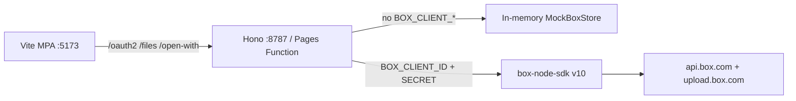

# How it works

This demo is a thin slice of **Box as an Open-with traffic channel** for a Lumin-like PDF editor. Lumin already sees a large share of tagged entries from **Google Drive’s Open with**. Box contributes none today. The integration shape is the same idea: the storage provider launches the editor against **one file**, the editor writes **back to that file**, and the provider keeps history.

## Box Web App Integrations (Open with)

A Box **Platform App** (OAuth 2.0) can register a **Web App Integration**. When a user opens a file’s more-options menu, Box shows the integration for matching extensions (here: `pdf`). Choosing it opens the **Client Callback URL** as a popup or new window.

Callback parameters are configured in the Developer Console as **name + method + placeholder**:

| Console placeholder | Typical query name | Meaning |
| --- | --- | --- |
| `#file_id#` | `file_id` | Box file to download / version |
| `#auth_code#` | `auth_code` | Short-lived OAuth **authorization code** |
| `#user_id#` | `user_id` | Box user who invoked the menu |
| `#file_extension#` | `file_extension` | `pdf` |
| `#redirect_to_box_url#` | `redirect_to_box_url` | Close the popup and refresh All Files |

Box substitutes the placeholders and issues GET or POST to the callback. This demo’s callback is `/open-with`, which 302s to `/editor.html?file_id=&auth_code=&user_id=`.

Popup panels may load in an iframe; production apps should serve HTTPS and a tight `Content-Security-Policy: frame-ancestors https://*.box.com`. The mock browser uses a same-origin navigation so the flow is easy to record.

## OAuth 2.0 authorization code

`#auth_code#` is **not** an access token. The editor (or its backend) exchanges it:

```
POST /oauth2/token
grant_type=authorization_code
code=<auth_code>
client_id=...
client_secret=...
```

Box returns `access_token`, `refresh_token`, `expires_in`, and often `restricted_to` describing the **file-scoped** grant (`item_readwrite` on that `file_id`). Web App Integration codes are typically scoped to the item that was opened, which is tighter than a full `root_readwrite` user login.

This repo:

- **MOCK**: in-memory codes (`acode_mock_…`) and tokens (`atok_mock_…`) with `restricted_to` pointing at the seeded file.
- **LIVE**: `box-node-sdk` v10 `BoxOAuth.getTokensAuthorizationCodeGrant`, then `BoxClient` + `BoxDeveloperTokenAuth` for file APIs.

Client secrets stay on the server. `.env` is gitignored; only `.env.example` is committed.

## File versions and etag / If-Match

Box versions a file when you **upload content to the same id**:

```
POST https://upload.box.com/api/2.0/files/{file_id}/content
Authorization: Bearer …
If-Match: <etag>
multipart: attributes={"name":"…"}  (must come first)
           file=<bytes>
```

The JSON resource includes `etag` (and `sequence_id`). Passing that value as `If-Match` makes the write fail with **412 Precondition Failed** if anyone else updated the file since you last `GET /files/{id}`. That is optimistic concurrency: you do not clobber a parallel Box Web edit.

`GET /files/{id}/versions` returns **previous** versions. The **current** version lives on the file object (`file_version`). The UI concatenates them so a reviewer sees v1 → v2.

The mock server uses the same paths and shapes (`/oauth2/token`, `/files/:id`, `/files/:id/content`, `/files/:id/versions`) including `If-Match` and 412.

## Compared with Google Drive Open-with

| | Google Drive Open-with (what Lumin uses today) | Box Web App Integration (this demo) |
| --- | --- | --- |
| Launch | Drive file menu → Open with | Box file menu → Integrations |
| File pointer | Drive `fileId` (often plus `userId` / `state`) | `#file_id#` |
| Auth | Google OAuth / Drive install scopes | `#auth_code#` → `POST /oauth2/token` |
| Save-back | `files.update` media upload on the **same** file id | `POST /files/{id}/content` (new **version**) |
| Concurrency | Drive `etag` / `ifMatch` on update | Box `etag` / `If-Match` → 412 |
| History | Drive revisions | Box file versions |

Product-wise both are **editor-as-a-handler** for a cloud file, not “download a copy and upload a sibling.” The important Lumin behavior is **version, don’t fork**.

## Open → edit → save-back

```mermaid
sequenceDiagram
  actor User
  participant Box as Box (mock or live)
  participant CB as /open-with
  participant Lumin as Lumin editor
  participant API as Box API

  User->>Box: Right-click PDF → Open with Lumin
  Box->>CB: GET file_id=#file_id# auth_code=#auth_code# user_id=#user_id#
  CB->>Lumin: 302 /editor.html?file_id&auth_code&user_id
  Lumin->>API: POST /oauth2/token (authorization_code)
  API-->>Lumin: access_token (+ restricted_to file)
  Lumin->>API: GET /files/{id}  (etag)
  Lumin->>API: GET /files/{id}/content
  API-->>Lumin: PDF bytes
  User->>Lumin: Highlight / text / draw / signature
  Lumin->>Lumin: Flatten annotations (pdf-lib)
  Lumin->>API: POST /files/{id}/content  If-Match: etag
  alt etag matches
    API-->>Lumin: 200 Files (new etag, v2)
    Lumin->>API: GET /files/{id}/versions
    API-->>Lumin: previous = v1
  else someone else wrote first
    API-->>Lumin: 412 precondition_failed
    Lumin->>User: Conflict UI; refetch etag or reload
  end
```

## Mock vs live



Default path is mock. Live is opt-in and never required for CI or the attached screenshot/video.
