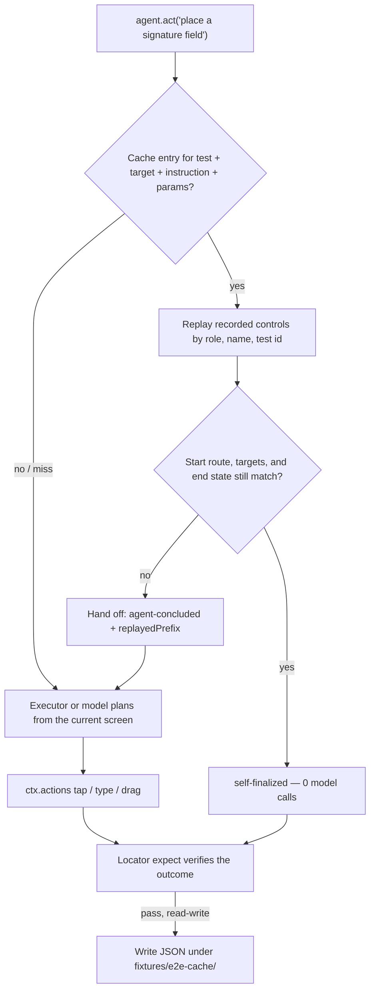
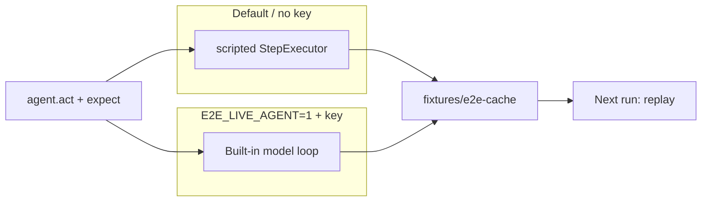
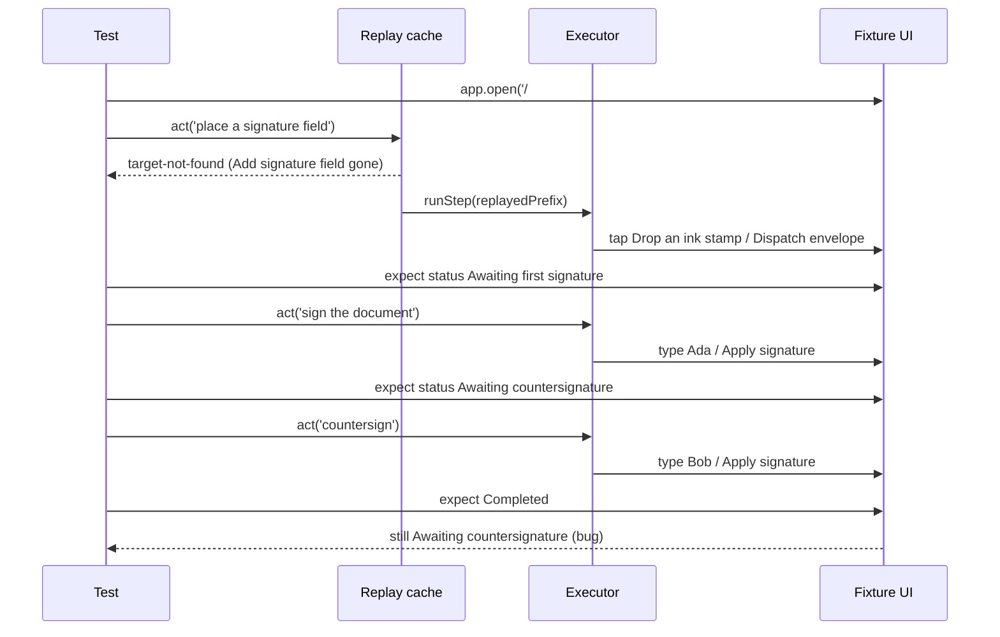

# How agent steps, recording, and drift detection work

This demo uses the published [e2e](https://github.com/tester-army/e2e) API only. Concepts below match [Core concepts](https://e2e.tester.army/docs/core-concepts), [Caching](https://e2e.tester.army/docs/cache), [How agent steps work](https://e2e.tester.army/docs/agent-steps), and [Custom executors](https://e2e.tester.army/docs/executors).

## Three kinds of step

| Step | API | Model call |
| --- | --- | --- |
| Goal | `agent.act('sign the document')` | Yes, unless the replay cache finishes it |
| Agent judgment | `agent.assert` / `waitFor` / `extract` | Always (not used in the default suite) |
| Locator | `screen.getByRole(...)` + `expect` | Never |

A later **locator** assertion is what confirms an `act` so e2e may record it. A plain `expect(value).toBe(...)` does **not** count as verification.

```ts
await agent.act('sign the document as {name}', { params: { name: 'Ada Lovelace' } });
await expect(screen.getByRole('status')).toHaveText('Awaiting countersignature');
```

## Record then replay



What must match for a hit (from the cache docs): the **test title**, **target**, **instruction**, **params**, **agent**, and **app identity**. The **model id does not** key the entry. The **URL fragment does not** count as the route — that is why `#drift` can change the UI on the same recorded routes.

Replay itself:

1. Same start route (origin + path + query; ids in the path are placeholders).
2. Find each recorded control; repeat its action.
3. Check the final route and the controls that appeared or went away.
4. Finish with no model call, or hand the current screen back to the executor.

## What this demo runs offline

The built-in agent needs a model. This repo defaults to the documented `StepExecutor` socket (`e2e/scripted-executor.ts`):

- `cache: 'inherit'` — recorded `act` steps replay without calling `runStep`.
- Planning uses `ctx.observe()` + `ctx.actions.*`, so the harness still records taps and types.
- `agent.assert` / `waitFor` / `extract` still need a model; the suite uses `expect` instead.

When `E2E_LIVE_AGENT=1` and `AI_GATEWAY_API_KEY` are set, `e2e.config.ts` swaps in the built-in model loop. Same tests, same cache keys (keyed by agent name + context, not by executor).



## UI drift vs a real bug

The **Simulate UI drift** toggle sets `sessionStorage` + `#drift`. Hash is ignored for route identity, so replay **starts** against the stable recording.

| Change | What e2e does | What a locator does |
| --- | --- | --- |
| `Finish` → `Apply signature`; Fields panel moves and is renamed **Marks** | Replay cannot find the recorded control (`target-not-found`) → `agent-concluded` or `missed` → executor re-plans from the current screen | Still exact: `getByRole('button', 'Finish')` would fail; this suite looks at **status** |
| Envelope never becomes **Completed** | Not a locator rename. The agent can still type both names | `expect(status).toHaveText('Completed')` fails. That is the injected product bug |

`tests/drift.e2e.ts` asserts the status stays **Awaiting countersignature**. `tests/bug-completed.e2e.ts` (excluded from the default glob) is the same flow with `toHaveText('Completed')` and is **expected to fail**.



## Cold vs cached replay

`/results` reads committed `public/fixtures/runs/cold.json` and `replay.json` (plus the drift run). Those files are produced by `bun run capture-results`:

| Fixture | How it was captured | Duration | Model calls | Cache |
| --- | --- | --- | --- | --- |
| Cold | `e2e run tests/envelope.e2e.ts --no-cache` | 2.31s | 0 offline (scripted). A live-agent cold run would increment this. | none (`--no-cache`) |
| Replay | Same test with `fixtures/e2e-cache/` | 1.96s | 0 (`self-finalized`) | 3 replayed |
| Drift | `E2E_VARIANT=drift` on the **same** test id | 46.23s | 0 offline | 2 handed off, 1 missed |
| Bug | `tests/bug-completed.e2e.ts` | 7.08s | 0 | `expect(Completed)` failed |

`--no-cache` sets cache mode `off` for that run: no replay and no write. It does not delete committed entries.

## Telemetry

The CLI can send anonymous command/engine counts. This demo sets `E2E_TELEMETRY_DISABLED=1` on every npm script, in `.env.example`, and in the README. See [Telemetry](https://e2e.tester.army/docs/telemetry).
