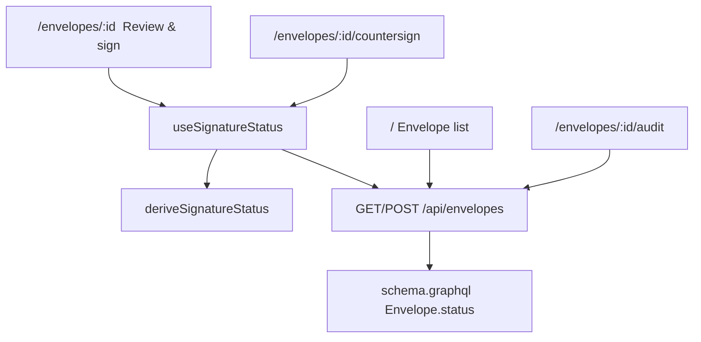
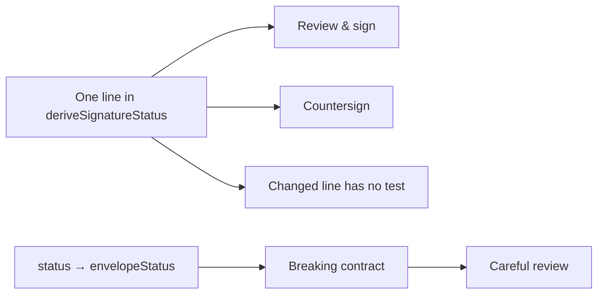

# How farol scores this fixture

[farol](https://github.com/winnin/farol) (Portuguese for *lighthouse*) is a CLI / GitHub Action that answers a question an LLM review usually cannot: **how risky is this merge, and which existing pages or APIs run the changed code?** It reads the TypeScript compiler’s program (or `go/types` / Python `ast`), not a model. The same diff always yields the same report. It never executes the app and never sends code anywhere.

```mermaid
flowchart LR
  diff[git diff merge-base..head] --> ts[TypeScript program]
  ts --> pages[Entry points: React Router pages]
  ts --> graph[Declaration graph]
  graph --> reach[Reach: changed decl → pages]
  reach --> score[0–100 score + verdict]
  cov[Optional coverage / lint] --> score
  gql[GraphQL SDL + REST regs] --> contracts[Contract compare]
  contracts --> score
```

## What farol actually does

1. **Diff** the merge-base and the head (whitespace / trailing-comma noise dropped).
2. **Read both trees** with the compiler API. For this app:
   - **Frontend** (`farol.config.json`): `createBrowserRouter` in `src/routes.tsx` → pages `/`, `/envelopes/:id`, `/envelopes/:id/countersign`, `/envelopes/:id/audit`, `/farol`.
   - **Backend** (`farol.backend.config.json`): Express `app.get/post` in `server/app.ts` plus `server/schema.graphql`.
3. **Hash declarations** (tokens, no comments). Only changed functions/variables count as existing code.
4. **Reach**: reverse walk from those declarations to every page or operation that runs them. That is the blast-radius map (file chain included).
5. **Classify and score**: `isolated` / `touches-existing` / `global` / `unknown`. Verdict is fast track, quick review, or careful review. Breaking contracts force careful. Missing coverage is “not verified”, never a pass.

A one-line change to a shared hook is the example farol’s own README leads with: skim the diff and you miss the forty pages. Here the hook is small on purpose so the reach map is readable.

## How this Lumin Sign fixture is wired



- Review and countersign **both** import `useSignatureStatus`. The readiness one-liner lives in `deriveSignatureStatus`.
- The list page does **not** import that helper. A typo-only edit there should not light up countersign.
- The envelope JSON field `status` is part of the GraphQL contract farol compares. Renaming it to `envelopeStatus` is a breaking response change for any client still reading `status`.

## Scenario A — harmless

Overlay: `scenarios/A-harmless/src/pages/EnvelopeList.tsx`

| Change | Why it is low risk |
|---|---|
| `Recieved for signature` → `Received for signature` | Copy on one page. No shared helper. No schema. |

**Recorded:** 16/100, ◐ quick review, class `touches-existing`. Reach is only `/` via `EnvelopeList`. farol does **not** fast-track an existing page function, even when the edit is a typo. That is still the low-risk side of the contrast: no countersign, no contract break.

## Scenario B — quiet blast radius

Overlays under `scenarios/B-blast-radius/`:

| File | Change |
|---|---|
| `src/hooks/signatureStatus.ts` | `envelope.status === "awaiting_signature"` → `envelope.status !== "voided"` |
| `server/schema.graphql` | `Envelope.status` → `Envelope.envelopeStatus` |
| `server/serialize.ts` | REST JSON field renamed the same way |



**Recorded:**

1. **Reach map (frontend, 30/100, quick review):** `/envelopes/:id` and `/envelopes/:id/countersign` via `ReviewSign`/`Countersign` → `useSignatureStatus` → `deriveSignatureStatus`. Line 70 uncovered.
2. **Contract-break (backend, 66/100, careful review):** `Envelope.status` removed on `Query.envelopes`, `Query.envelope`, `Mutation.signEnvelope`.
3. Frontend alone stays *quick review* (score 30). **Careful** comes from the backend contract break — farol’s `surface` is one or the other, so the script runs both.

The default `bun run dev` app stays on the baseline (planted typo, original `status` field). Scenario B is a farol diff, not the running UI.

## Why two farol configs

farol’s `surface` is either `frontend` or `backend`. Pages and GraphQL contracts are different entry-point sets, so the script runs analyze twice for B. Combined, they are the review a human would want after an AI already commented on the diff: *where it lives*, and *whether clients can break*.

## Reproduce

```bash
cd apps/farol-esign-risk
bun run farol:routes        # what farol sees on this tree
bun run farol:scenarios     # sandbox git + analyze + html
```

Reports: `fixtures/reports/scenario-a/` and `fixtures/reports/scenario-b/`. How farol computes weights is in [farol’s how-it-works](https://github.com/winnin/farol/blob/main/docs/how-it-works.md); this file only explains the fixture.
