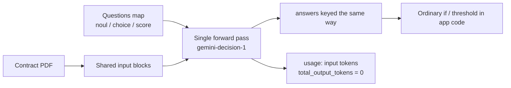
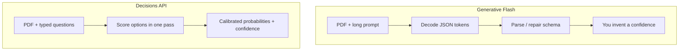
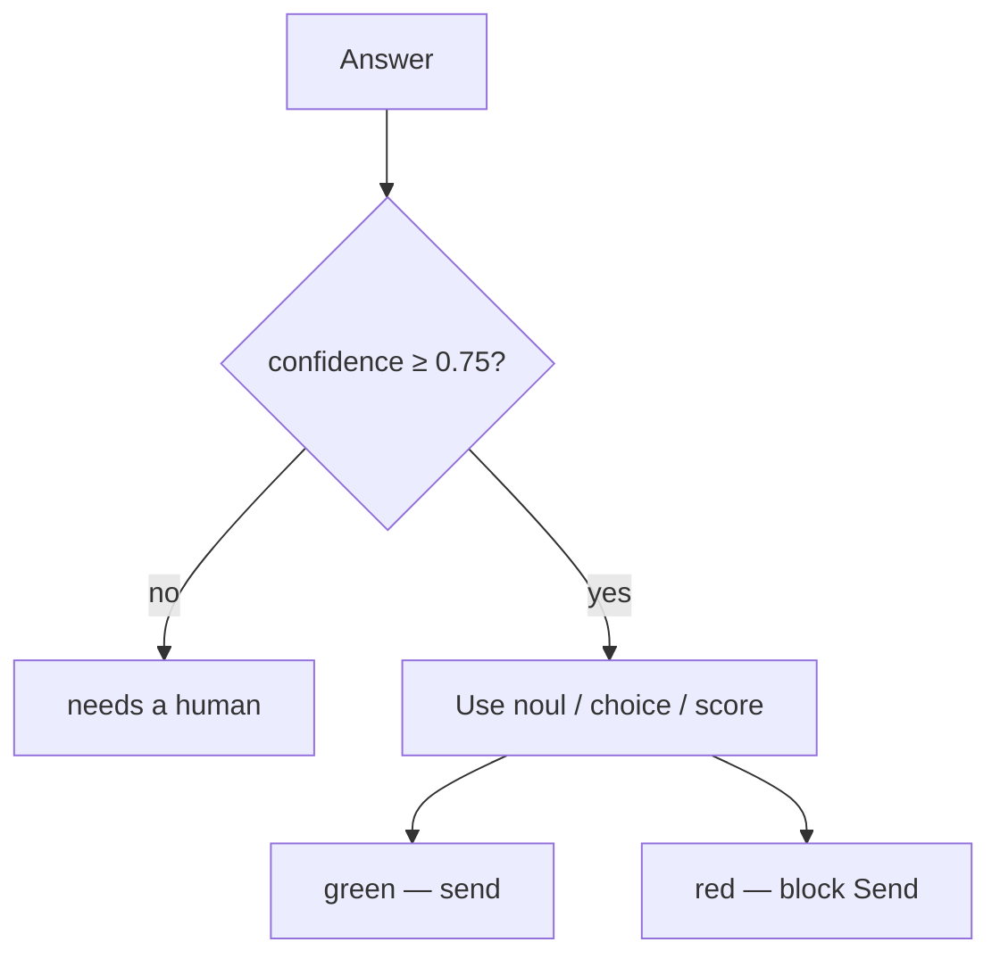

# How the Gemini Decisions API works

Generative Gemini writes tokens for a person to read. The [Decisions API](https://aistudio.google.com/docs/decisions-api) does the opposite: it **scores closed-set outcomes** and returns numbers your code can branch on. There is no answer text.

This demo uses that for a Lumin Sign **send-ready preflight**: one contract PDF + ~40 typed questions in a single call.

## Classification, not generation

`gemini-decision-1` takes:

1. Shared `input` — here a PDF `document` block (same content-block shape as the Interactions API).
2. A map of `questions` (1–1,000 keys). Each question is one of:

| Type | Meaning | Returns |
| --- | --- | --- |
| `noul` | Yes/no: probability the statement holds | `noul` (0.01–0.99), `confidence` |
| `choice` | Exactly one option from a fixed list | `choice`, `probabilities`, `confidence` |
| `score` | Ordered rubric, levels from 0 | `score` (probability-weighted), `legend`, `probabilities`, `confidence` |

The model never sees your question keys. Write the full question in `instructions`. Questions are scored **independently** against the same input; adding one does not change the others.

## Why output tokens are free

Decoding text is the slow, billed part of a normal generate call. Decisions **does not decode**. It scores option heads in one prefill-style pass, so `usage.total_output_tokens` is always **0**. You pay input only ($0.10 / 1M tokens on the paid Decisions tier). Shared input is billed once no matter how many questions you attach; each question adds only its own instruction/criteria tokens.

That is why this preflight can ask ~40 send checks at once without a 40× generate tax.

## Confidence thresholds

Every answer includes `confidence` in `[0, 1]` — the chance the **top** outcome is right:

- `noul`: `confidence = max(noul, 1 - noul)`
- `choice` / `score`: `confidence` is the top option/level probability

This app treats `confidence < 0.75` as **needs a human**. Above that:

- Issue-style yes/no (`empty_date_fields`, missing exhibits, …) → red if yes
- Requirement-style yes/no (signature block present, …) → red if no
- Choice fail values (`unspecified` law, `without_notice` renewal) → red
- Rubrics: overall risk **above** 1.75 is red; sign-readiness / completeness **below** 1.5 is red

Do not treat `noul ≈ 0.5` as a “medium” severity. That is **uncertainty**. Use a `score` rubric when you want a spectrum.

## One pass, many questions

REST (this repo’s live client):

`POST https://generativelanguage.googleapis.com/v1beta/decisions`  
header `x-goog-api-key`  
body `{ "model": "gemini-decision-1", "input": [...], "questions": { ... } }`

The PDF is sent once as `{ "type": "document", "data": "<base64>", "mime_type": "application/pdf" }`. All signature, exhibit, law, and rubric checks run in that same request. The UI then **composes** answers in TypeScript (for example: hide MSA-only payment checks when `document_type` is `nda`).

## This demo’s two adapters

| | When | Writes eval to |
| --- | --- | --- |
| Mock | `DECISIONS_MODE=mock` or no `GEMINI_API_KEY` | `results/mock/` only |
| Live | key set and mode `auto`/`live` | `results/` |

Mock responses use the same JSON shape as the docs (`answers` + `usage`) and are labeled **MOCK**. They are not a quality claim. Live numbers live in `results/` (keep `results/mock/` for the adapter wiring).

## What our eval found

Owner-run live bake-off, four synthetic fixtures, **156 checks** (39 × 4). Full tables: [`results/SUMMARY.md`](./results/SUMMARY.md).

| | Decisions `gemini-decision-1` | Generative `gemini-3.5-flash-lite` |
| --- | --- | --- |
| Accuracy vs ground truth | **98.1%** | **96.8%** |
| Planted-issue precision | 100% | 100% |
| Planted-issue recall | **100%** | **96.9%** |
| Latency p50 | **560 ms** | **6109 ms** |
| Latency p95 | **720 ms** | **18656 ms** |
| Est. cost per document | **~$0.0004** | **~$0.006** |

Caveats, stated plainly:

- The generative baseline is **Flash-Lite**, not Flash. `gemini-3.5-flash` and newer Flash models returned **503 high-demand** for this key, so the comparison is Decisions vs Flash-Lite structured JSON.
- Generative p50/p95 **include 503 retry waits** on the two NDA fixtures. Those latencies are not a fair model-compute comparison.
- Both models **missed the three rubric scores** (`overall_risk`, `sign_readiness`, `completeness`) on `nda-planted` (36/39 each). Boolean and choice checks were otherwise strong.
- **Only four synthetic fixtures.** Directional, not a production quality claim.

Set `GENERATIVE_MODEL` to try another Flash id on a re-run; do not overwrite `results/` unless you intend to replace the owner eval.
