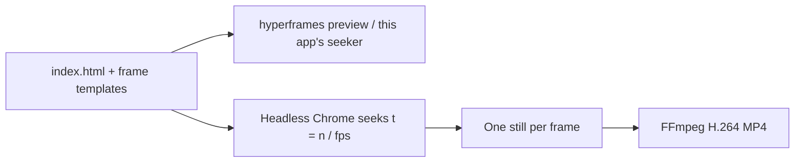
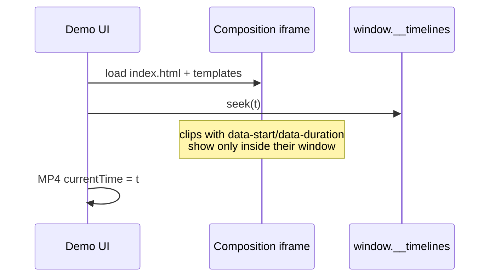

# How HyperFrames turns this fixture into MP4

Concept note for `apps/hyperframes-esign-video`. Not an API reference.

Upstream: **[heygen-com/hyperframes](https://github.com/heygen-com/hyperframes)** (Apache-2.0), pinned at CLI **0.8.174**. Videos are ordinary HTML/CSS plus a seekable animation runtime (here: GSAP 3.14.2). The CLI drives headless Chrome frame-by-frame and encodes with FFmpeg.

## HTML-to-video rendering

A composition is an HTML file. The root declares canvas size and duration (`data-width`, `data-height`, `data-duration`, `data-composition-id`). Timed nodes are clips (`data-start` + `data-duration`). This demo’s launch film is **modular**: `index.html` hosts six sub-compositions via `data-composition-src`. Each frame file is a bare `<template>` whose contents the runtime clones into the host slot.



Nothing plays in wall-clock time during render. Frame 0 is a seek, frame 1 is a seek, and so on. That is why the same input is supposed to produce the same pixels.

The product-launch assembler (`product-launch-video/scripts/assemble-index.mjs`) wrote the host `index.html` from `STORYBOARD.md`. We did **not** invent that host shape.

## Seekable timeline

GSAP is the animation runtime. Each composition registers **one** paused timeline:

```js
const tl = gsap.timeline({ paused: true });
tl.fromTo("#title", { opacity: 0, y: 28 }, { opacity: 1, y: 0, duration: 0.7 }, 0.35);
window.__timelines["01-hook"] = tl;
```

The registry key must match `data-composition-id`. HyperFrames seeks `tl` to the requested time; it owns clip visibility and media playback. Tweens use `fromTo` so a backward seek does not depend on whatever the playhead last touched.

The in-app preview is a small loader: fetch `index.html`, clone each `<template>` into its host, then `timeline.seek(localTime)` while toggling clip `visibility` from `data-start`/`data-duration`. It is not Studio, and it is not a second renderer.



## Determinism

Rules the skills actually document (`hyperframes-core/references/determinism-rules.md`):

- No `Date.now()` / `performance.now()` / unseeded `Math.random()` for visual state
- No render-time network for required assets (fonts are local `.woff2`)
- No hover/scroll/pointer as the source of truth
- Finite root `data-duration`; `repeat: -1` only inside that window
- Do not tween `visibility`/`autoAlpha` on a `.clip` (the framework owns that)

**Honest check in this demo:** `bun run check:determinism` hashes the committed MP4, optionally re-renders with the same CLI flags, hashes the new MP4, then extracts PNGs at 1s / 8s / 16s / 24s and hashes those. MP4 **container** hashes often differ (encoder timestamps, metadata) even when pixels match. PNG hashes are the visual comparison. The JSON in `public/renders/determinism.json` reports whatever actually happened — including mismatches or a skipped re-render.

This VM’s first `hyperframes doctor` used **system Chrome screenshot capture** (slow path). Renders in this demo used **`chrome-headless-shell` + beginFrame** via `HYPERFRAMES_BROWSER_PATH` (not committed). PNG frame hashes still matched across a re-render; the launch MP4 **container** hash did not.

## Agent skills

Published skills, installed with `npx hyperframes@0.8.174 skills update …`, not invented prompts:

| Skill | What we used it for |
| --- | --- |
| `/product-launch-video` | Launch film: `init --skill=product-launch-video`, `BRIEF.md`, no-capture inventory, `build-frame.mjs --preset blue-professional`, `STORYBOARD.md`, frame templates, `assemble-index.mjs`, `render --skill=product-launch-video` |
| `/pr-to-video` | PR film: `init --skill=pr-to-video`, real `fetch-pr.mjs` + `ingest.mjs` against `sonlexqt/tech-demos#24`, `build-frame.mjs --preset code-editorial`, storyboard + frames, assemble, render |
| `/hyperframes-core` | Composition contract, sub-comps, determinism |
| `/hyperframes-cli` | `lint` / `check` / `render` / `doctor` |

```mermaid
flowchart TB
  subgraph launch ["/product-launch-video"]
    B1[BRIEF.md] --> C1[capture/extracted no-URL path]
    C1 --> F1[frame.md blue-professional]
    F1 --> S1[STORYBOARD.md]
    S1 --> H1[compositions/frames/*.html]
    H1 --> I1[assemble-index.mjs → index.html]
    I1 --> R1["hyperframes render → MP4"]
  end
  subgraph pr ["/pr-to-video"]
    B2[BRIEF.md + PR URL] --> G[fetch-pr.mjs via gh]
    G --> IN[ingest.mjs offline]
    IN --> F2[frame.md code-editorial]
    F2 --> S2[STORYBOARD.md]
    S2 --> H2[frame HTML]
    H2 --> R2[render]
  end
```



Autonomous / offline choices that are real, not hidden:

- HeyGen `auth status` was **signed out** (exit 1 is the normal signed-out state).
- Kokoro TTS and MusicGen were **not installed**, so both films are silent (`music: none`, no `SCRIPT.md`).
- Canvas is **1280×720** (valid `format: 1280x720` in the storyboard parser) so committed MP4s stay small.
- Live `gh` worked for PR #24; `videos/pr-24-walkthrough/capture/` is committed so the demo remains reviewable without GitHub.
