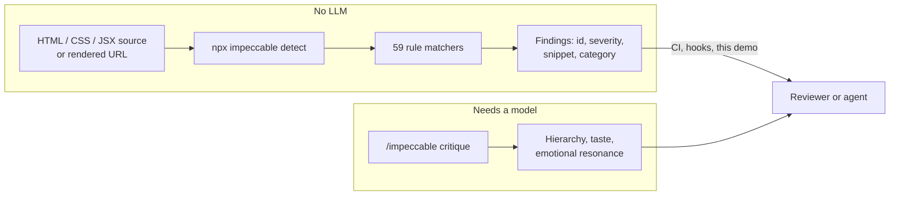
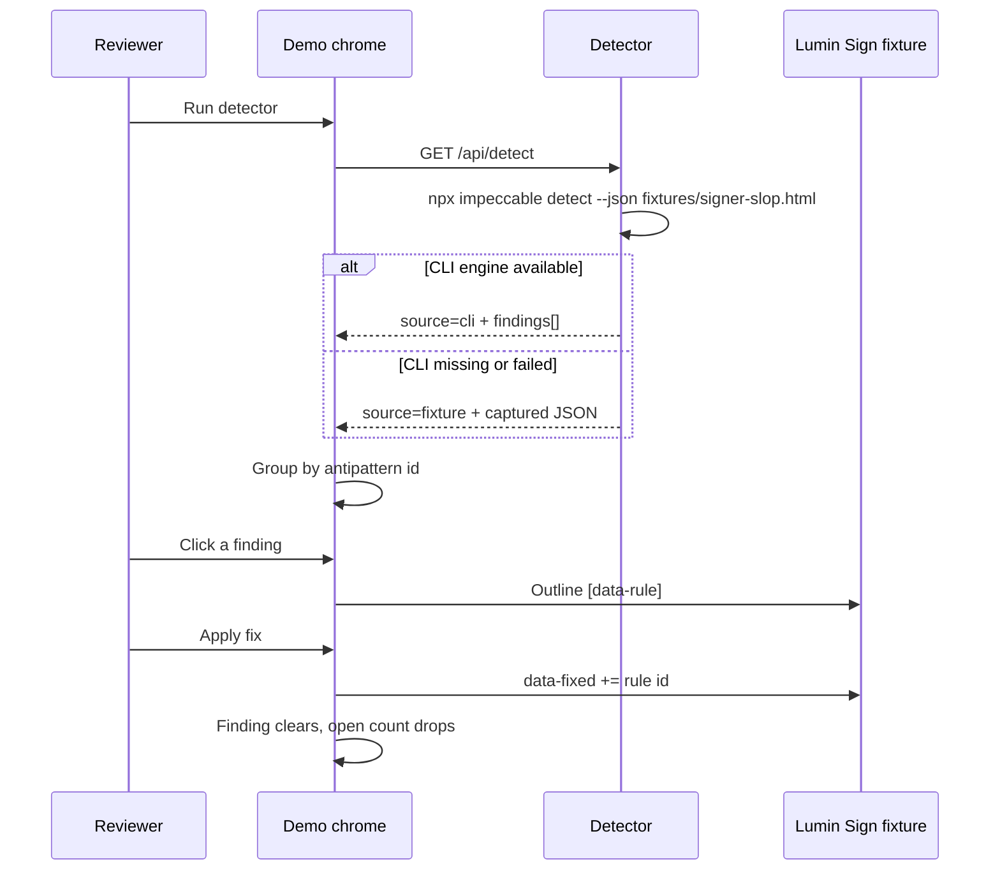
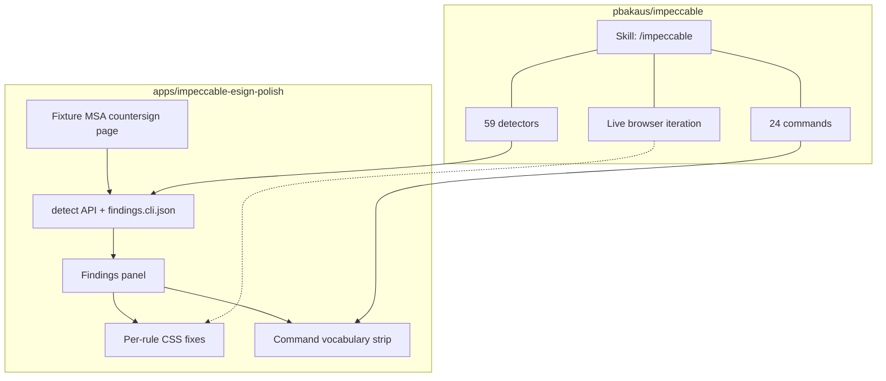

# How this demo works

Impeccable is a design vocabulary for AI coding agents: **1 skill**, **24 `/impeccable` commands**, live browser iteration, and **59 deterministic detector rules**. This demo is the detector — not a restyle gallery.

## Deterministic detectors vs LLM critique

The CLI and browser extension run the 59 rules with **no API key**. Exit `0` = no primary findings (advisories may remain). Exit `2` = primary findings. Exit `1` = a target could not be scanned.

`/impeccable critique` is a different layer: it uses an LLM to judge things the regex/layout engines will not (identical-card grids as a design problem, hero-metric taste, “does this page feel like a signing desk”). This app never calls that layer.

## Detect → findings → fix loop

Each finding card shows:

| Field | Source |
| --- | --- |
| Detector id | CLI `antipattern` (`side-tab`, `gray-on-color`, …) |
| Severity | `warning` or `advisory` |
| Element / snippet | Mapped selector + CLI `snippet` |
| Why it matters | E-sign specific note (not in upstream) |
| Command | Which of the 24 `/impeccable` verbs would address it |

Applying a fix is the **live-mode analogue**: the page updates immediately. The HTML file the CLI scans is unchanged until someone edits `fixtures/signer-slop.html` and runs `bun run detect`.

## How the demo maps to Impeccable

| Impeccable piece | In this demo |
| --- | --- |
| `npx impeccable detect` | Vite `/api/detect` + `bun run detect` |
| Rule catalog | Real ids from a scan of `fixtures/signer-slop.html` |
| `/impeccable colorize` | Fixes `ai-color-palette`, `gradient-text`, `gray-on-color` |
| `/impeccable typeset` | Fixes `overused-font`, `tiny-text`, `tight-leading` |
| `/impeccable layout` | Fixes `nested-cards` |
| `/impeccable polish` | Fixes `side-tab`, `broken-image` |
| `/impeccable quieter` | Fixes `dark-glow` |
| `/impeccable audit` | Fixes `low-contrast`, `skipped-heading` |
| `/impeccable clarify` | Fixes `marketing-buzzword` |
| `/impeccable critique` / `craft` / `live` | Shown in the vocabulary; not executed (LLM or harness) |

The fixture is a **Lumin Sign** signer review-and-sign surface (envelope MSA-2026-4412, Northwind ↔ Lumin countersign). Slop is intentional so the detector has something to say. After fixes, the same task remains — review the MSA and sign — without the AI tells.
