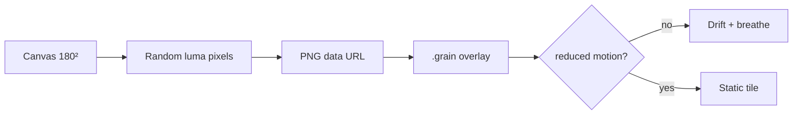
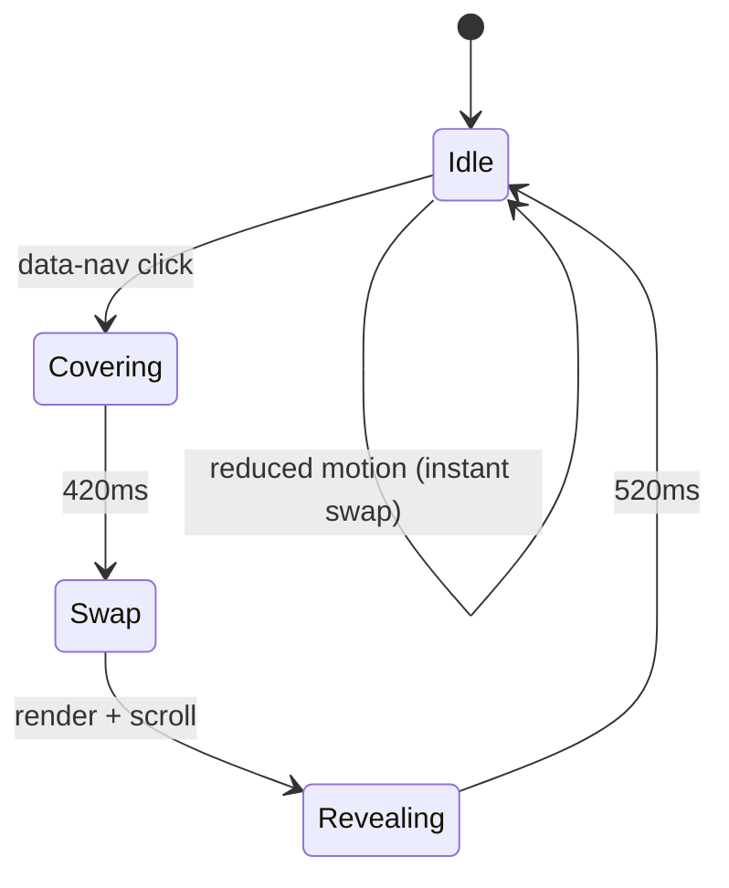

# How it works

Original techniques for a cinematic Lumin catalog. Nothing here is copied from a live portfolio.

## Layout rhythm

The page is a single content column (`--content: 72rem`) with a tight nav, a large serif display, and a card grid that steps from 1 → 2 → 4 columns.

Type contrast does the “premium catalog” work:

| Role        | Face                 | Size idea                         |
|-------------|----------------------|-----------------------------------|
| Wordmark    | Outfit (sans)        | 0.78rem, 0.42em tracking          |
| Display     | Cormorant Garamond   | `clamp(4.6rem, 14vw, 10.5rem)`    |
| Card title  | Cormorant            | ~1.85rem                          |
| Meta        | Outfit               | ~0.64–0.68rem, uppercase          |

Vertical spine (“Grain / Catalog”) and an ember-colored eyebrow keep the hero from becoming a generic landing block.

```
┌──────────────────────────────────────────┐
│  LUMIN                         CATALOG   │
│                                           │
│  INTERNAL SHOWCASE                        │
│  Lumin                          GRAIN/    │
│                                 CATALOG   │
│  01 Sign · 02 MSA · 03 Redact · …         │
│                                           │
│  ┌────┐ ┌────┐ ┌────┐ ┌────┐              │
│  │still│ │still│ │still│ │still│            │
│  └────┘ └────┘ └────┘ └────┘              │
└──────────────────────────────────────────┘
```

## Film grain

`src/grain.ts` paints a 180×180 grayscale noise tile on an offscreen canvas and exposes it as a CSS `url()` on `.grain`.

The overlay is `position: fixed`, `pointer-events: none`, `mix-blend-mode: overlay`, ~11–16% opacity. A slow `background-position` drift plus a 7s opacity breathe keeps the grain alive without looking like a GIF.

If `prefers-reduced-motion: reduce` is set (or becomes set), animation stops and opacity drops. The static tile remains so the surface still has tooth.



## Page wipe

Clicks on `a[data-nav]` are intercepted (`src/router.ts`). `playWipe` in `src/transitions.ts` drives a two-blade shutter (`.shutter__blade--top` / `--bottom`):

1. **Cover** — blades `scaleY(1)` from the outer edges (420ms).
2. **Swap** — History API `pushState`, re-render, scroll to top.
3. **Reveal** — blades retract toward the center seam (520ms).

Easing is `cubic-bezier(0.76, 0, 0.18, 1)`. Reduced motion skips the shutter and swaps immediately.

This is a few dozen lines of CSS/TS — not Barba, not a cloned transition stack. View Transitions API is intentionally unused so timing and reduced-motion stay fully local.



## Card hover

Cards are 3:4 stills (SVG geometry, unique per study). A caption sits at the bottom, translated down and faded. Hover/focus-within:

- still scales to `1.045`
- caption returns to `translateY(0)` and full opacity

Under reduced motion the caption is always visible and the scale is removed.

## Routing

Single `index.html` SPA. Vite `appType: "spa"` serves the shell for `/about` and `/item/:slug`. `parsePath` maps:

- `/` → catalog
- `/about` → study notes
- `/item/:slug` → detail (or “not in the catalog”)

Focus moves to `[data-focus-title]` after each render so keyboard users land on the new heading.

## What was deliberately not done

- No fetch/scrape of third-party HTML/CSS/JS/fonts/images
- No A24 titles, posters, or commercial font files
- No theme toggle (dark editorial only)
- No production Lumin APIs — copy is fictional and Lumin-flavored
