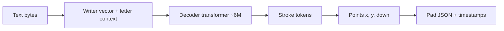
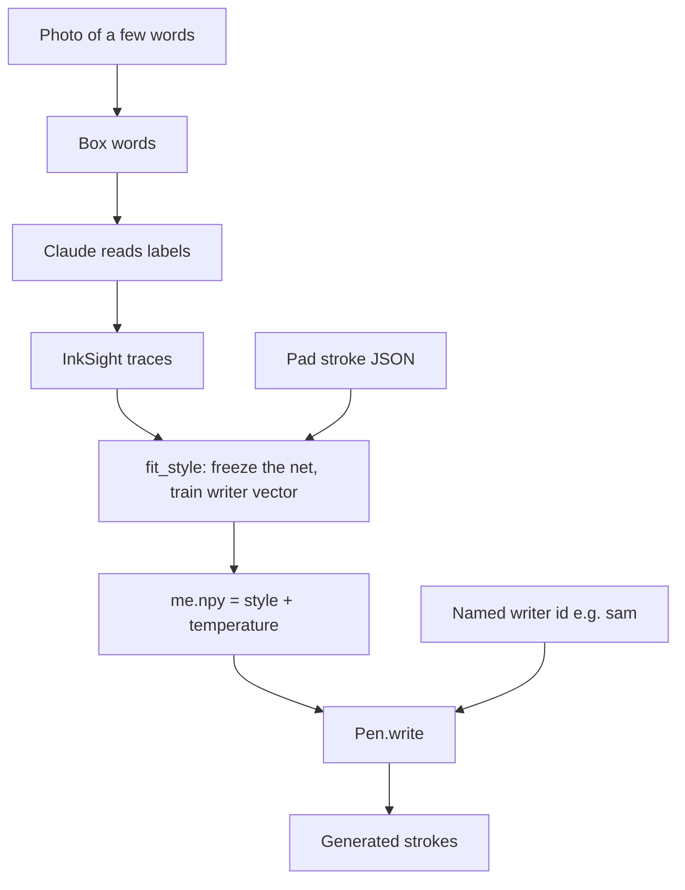
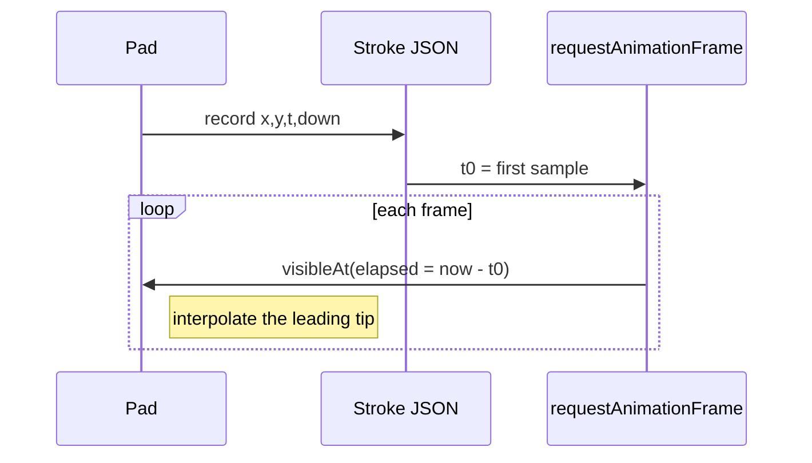

# How PenGPT Signature Lab works

## PenGPT models handwriting as stroke tokens

Pen points are snapped to a grid. Motion is a walk on that grid: eight compass
steps plus `DOWN` and `UP`. BPE merges common runs, so one token is already a
short stroke. The handwriting model (packed `hand.npz`) is a nanochat-style
decoder with rotary positions, RMSNorm, and **cross-attention over what it is
told**: the bytes of the text, plus **one learned vector for the writer**.

`Pen.write(text, writer)` (in `inference/pen.py`) returns each word as an
`(N, 3)` array: `x`, `y`, and a pen-down flag. **There is no time channel.**
Long lines are written two words per call, each call continuing from the last
word so the hand stays steady.

## Style conditioning from a sample

Three inputs the real API accepts as `writer`:

1. A **string id** from `pen.writers` (1,192 trained hands). Numpy only.
2. A **style vector** `ndarray`, the first `n_embd` entries of `me.npy` from
   `inference/hand.py`. Photo path: box words, transcribe, trace with InkSight,
   then `fit_style` (Adam on the writer embedding, model frozen). Temperature
   is matched to how unpredictable the photo’s ink is. Needs torch + an
   Anthropic key.
3. The same `fit_style` on points built from a **stroke file** (`--fit-style`
   in our wrapper).

This lab’s shipped generated fixtures use path (1) with named writers so the
demo is reproducible without torch. The wrapper still implements (2) and (3)
for a laptop.

## Replay pipeline

The pad records CSS-pixel samples with `performance.now()` deltas, same idea as
a draw-to-sign control. Replay maps **wall clock → recorded `t`**, not to a
fixed mm/s plotter. Generated files must invent `t` because PenGPT never had
it: the wrapper uses a **regular ~12 ms lattice** and nearly constant speed.
That invented clock is itself a forensic feature, and an attacker would invent
one too.

## Forensics features

| Feature | What it looks at | Typical tell |
| --- | --- | --- |
| Speed profile | px/ms along each stroke | Humans vary; models+wrappers often do not |
| Acceleration / jerk | derivatives of speed | Minimum-jerk start/end bump vs flat |
| Pause distribution | gaps between strokes | Lognormal vs even |
| Pen-up count / stroke order | down-runs | Too few lifts, or too regular |
| Timing regularity / Δt CV | sample clock | 12 ms lattice from our wrapper |
| Point-sampling jitter | \|Δt − median Δt\| | Tight for a plotter |
| Grid snap | coordinates on a coarse lattice | PenGPT 0.02-grid heritage |
| Time-grid snap | Δt near 12 ms multiples | Wrapper signature |

`looksHumanScore` is a logistic mix of those numbers, threshold 0.5, reported
on each file and as accuracy over the four volunteer pairs.

### What it can detect (in this lab)

- Regular invented clocks (the default PenGPT wrap).
- Very constant speed and missing start/end slowdown.
- Sometimes leftover spatial quantization.

### What it cannot detect

- A person **tracing** generated ink on a pad (human clock, generated shape).
- An attacker who **resamples** model geometry with minimum-jerk timing and jitter.
- Whether the *letters* look like the volunteer (no shape model here).
- A different generator that emits time natively.
- Production fraud: four fixtures are not a population.

That gap is the product point. A drawn-signature audit trail is cheap to fake
**and** cheap to launder. Lumin Sign should not overweight pad telemetry versus
identity proof (Lumin ID).
