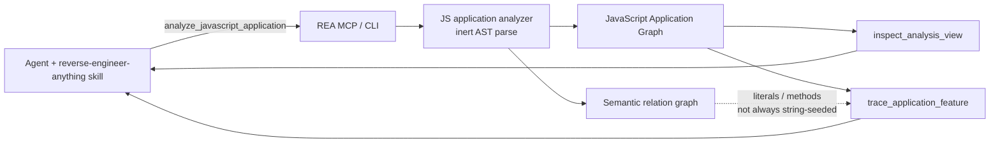
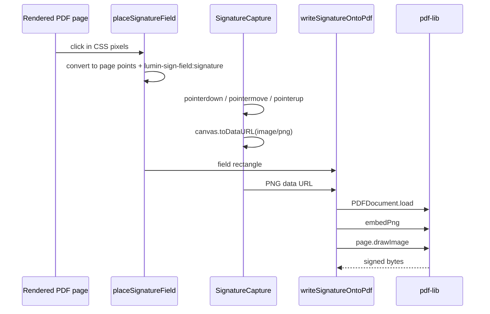

# How REA analyzes a JavaScript bundle

[REA](https://github.com/morluto/rea) (`rea-agents`, MIT) is a **local** reverse-engineering toolkit: one CLI and one MCP server, plus the `reverse-engineer-anything` agent skill. This demo uses only the **JavaScript application path**. Native engines (Ghidra, Hopper, IDA) are out of scope.

Setup for an agent host is `npx rea-agents setup`. That registers the MCP server and installs matching workflow instructions. This playground does **not** require that setup: it replays committed CLI output so a reviewer can see the same Evidence without keys or a live model.

## Concepts

REA distinguishes four things and keeps them separate:

| Kind | Meaning in this demo |
| --- | --- |
| **Observation** | Bytes or AST syntax REA actually read (string literals, `import` specifiers, `addEventListener` callees). |
| **Inference** | A relationship derived from syntax (`imports`, `exposes`, HTML script `loads`). Syntax does not prove the code ran. |
| **Unknown** | A fact REA cannot justify (unresolved `pdf-lib` because it was externalized; dynamic names). |
| **Evidence** | A signed-off record (`evidence_id`, subject digest, operation, limitations). Later tools project or trace that record; they do not re-execute the app. |

Two graphs come back from `analyze_javascript_application`:

1. **JavaScript Application Graph** — packages, assets, modules, imports, HTML/Electron roles, coverage.
2. **Semantic relation graph** — literals, functions, property slots, expression reads/writes, call sites. Feature tracing on *application-graph* string seeds can miss a literal that the semantic graph still observed. The accuracy table shows that gap.

The skill tells the agent to start **summary-first**: analyze once, then `inspect_analysis_view`, then `trace_application_feature` with one literal seed. That is the same sequence `scripts/capture-rea.ts` recorded.

## MCP / CLI surface used here

| MCP tool | CLI | What we asked |
| --- | --- | --- |
| `analyze_javascript_application` | `rea analyze-javascript-application DIR --json` | Inventory `fixtures/signer-bundle/`, parse `signer.min.js` as inert text, build both graphs. |
| `inspect_analysis_view` | `rea inspect-analysis-view INPUT --json` | Project a summary (artifact digest, statistics, Electron surface counts) from the saved Evidence. |
| `trace_application_feature` | `rea trace-application-feature INPUT --json` | Seed the application graph with signing-flow strings (`lumin-sign-field:signature`, `pointerdown`, …). |

REA never `eval`s the bundle. The analyzer is a separate process that parses source; Webpack/`push` handlers are not invoked.

## Investigation flow

## What the owned signer actually does

REA recovered the **exported** names (`placeSignatureField`, `SignatureCapture`, `writeSignatureOntoPdf`, `runSigningFlow`) because ESM export strings survive `bun build --minify`. It recovered `pdf-lib` as an unresolved static import. It recovered `embedPng`, `drawImage`, `toDataURL`, and the pointer event literals.

It **missed** some application-graph string traces (`lumin-sign-flow:capture`, `pointerdown`) even though those strings exist as semantic literals. It **renamed** internal helpers (`clamp`, `decodePngDataUrl`). It **tagged** `package.json` + `index.html` as Electron main/renderer roles, which is a classification miss for this browser fixture.

The rebuilt pad in `src/signature-pad.ts` is a small standalone component written from those findings (event names, `toDataURL`, empty-ink error), not an import of the original module.

## Why the demo is offline by default

Full application Evidence can be large; even this 3 KB bundle produced a ~1.7 MB analyze envelope. The UI loads the compact `evidence-index.json` / `how-signing-works.json` projections. Raw CLI documents stay in `fixtures/rea-output/` for inspection. Live re-runs are gated by `REA_LIVE=1` and still need no model key.
