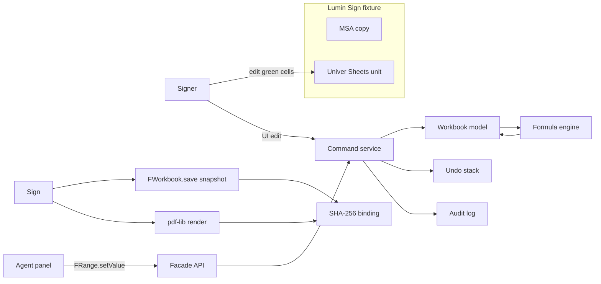
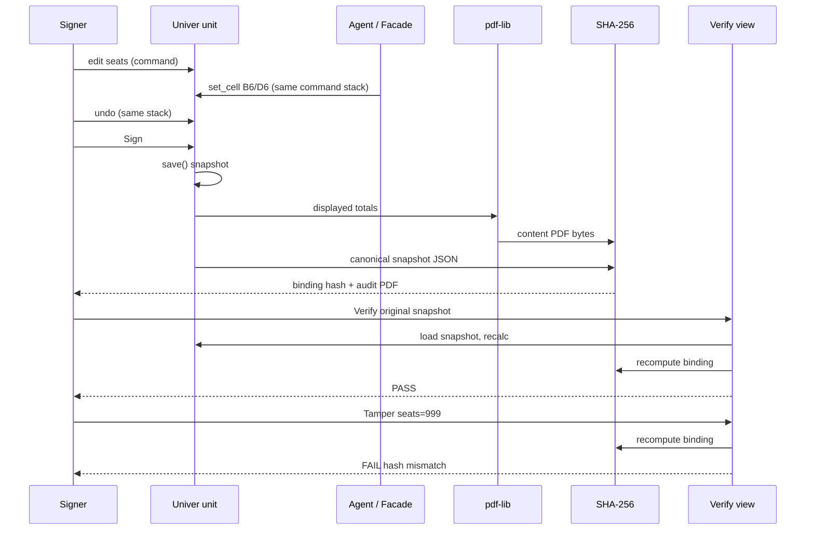

# How quote-to-sign on OSS Univer works

PandaDoc’s edge over DocuSign is **quote-to-sign in one document**: the commercial terms are not a static attachment — they calculate while the signer is still in the envelope. This demo asks whether [Univer](https://github.com/dream-num/univer) (Apache-2.0 core, v1.5.x) can host that live quote inside a fake Lumin Sign MSA, then freeze it into an immutable signed record **without** Univer’s commercial PDF/Office/Server/AI add-ons.

## Univer architecture (what we actually used)

Univer is a plugin document engine, not a spreadsheet iframe.

| Piece | Role in this demo |
| --- | --- |
| **Unit** | One workbook (`IWorkbookData` snapshot) is the Exhibit A pricing sheet. |
| **Plugins** | Browser: `@univerjs/preset-sheets-core` (sheets model, formula engine, renderer, UI). Tests: headless `@univerjs/core` + `@univerjs/sheets` + `@univerjs/engine-formula` (no ribbon). |
| **Snapshot** | JSON `IWorkbookData`. `FWorkbook.save()` captures the live unit, including cached formula results. Editing the JSON in place does nothing to a running unit — you must dispatch commands. |
| **Command system** | Every cell write is a command (`sheet.command.set-range-values`). Commands are the single mutation pipeline, which is why undo/redo (and collaboration, which we did not use) can exist. |
| **Facade API** | `FUniver` / `FWorkbook` / `FRange`. `range.setValue(40)` prepares and dispatches the command. Agent and human go through the same door. |
| **Formula engine** | `@univerjs/engine-formula`. Nested `IF` implements 20/50/100 seat discount tiers; line totals and tax are ordinary formulas. `onCalculationResultApplied` waits until cached `v` values update. |
| **Undo/redo** | `univerAPI.undo()` / `FWorkbook.undo()` pop the same stack the Facade push onto. An agent “40 seats” is therefore undoable like a keystroke. |

## Open-source vs commercial — what we avoided

Apache-2.0 in `dream-num/univer` covers the **core Web SDK**: content model, snapshot format, plugins, commands, formula + render engines, Facade, Sheets/Docs editing.

We **did not** take:

- Commercial **Office import/export**
- Commercial **PDF export** (`@univerjs-pro` / Server `exportToBuffer` / `ExchangeFormat.PDF`)
- **Server SDK** (collaboration, conversion, `univer-rs` snapshot service)
- **AI SDK** (Univer’s agent/worktree product)

PDF bytes in this demo are **our** `pdf-lib` drawing of the contract text plus the **displayed, computed** Exhibit A numbers. That is the point: a Lumin-like product can own the signed artifact even if the in-envelope calculator is OSS Univer.

Cell protection: Univer range-protection APIs exist on the OSS sheets model, but they are happiest with a permission service. The demo **fail-closes** with a `BeforeCommandExecute` interceptor so locked cells cannot change even if native protect is a no-op.

## Freeze: live doc → immutable signed record

Signing is not “export xlsx”. It is a **bind**:

1. **Freeze first.** The interceptor blocks every write (including previously editable cells and undo) *before* `save()`, so the snapshot cannot drift while pdf-lib runs.
2. Wait for the formula engine (`onCalculationResultApplied`). Sign treats a timeout as failure, not success.
3. Read displayed values (seats, term, add-ons, line totals, tax, grand total) from the live unit.
4. `FWorkbook.save()` → snapshot JSON.
5. Render a **content PDF** with pdf-lib from those displayed numbers (what the signer saw).
6. Canonicalize the snapshot (sorted keys, drop volatile scroll/rev fields).
7. `binding = SHA-256( utf8(canonical snapshot JSON) || content PDF bytes )`.
8. Append an **audit-trail page** (edit log + snapshot / content-PDF / binding hashes). The binding is over the content PDF *before* that page, so the hash is not circular.
9. Store `signedPdfSha256` of the **downloadable** PDF (content + audit page). Verify checks that digest too.
10. Viewer-mode if the permission API exists; the frozen interceptor is the real lock. Sign failure unfreezes.

Verify reloads the snapshot into a hidden Univer instance (disposed after), lets formulas recompute, compares **all** signed inputs and pricing lines to the live recompute, and recomputes both the binding and the signed-PDF digest. Tamper: rewrite `B6` in the JSON → snapshot hash and binding fail, and recomputed seats/total disagree.

## Lessons / hard parts for “quote-to-sign in one doc”

1. **The calculator must be the document.** A PDF with a pasted table is DocuSign’s world. A live unit with locked formulas is PandaDoc’s. Univer’s snapshot + formula engine is enough for the live half.
2. **Commands are the product surface for agents.** If the bot wrote `cellData` on the snapshot, undo and audit would lie. Facade → command is non-negotiable.
3. **Formula latency is real.** UI, audit, and Sign all have to wait for `calculationResultApplied` or they will freeze stale totals.
4. **OSS does not give you a signed artifact.** Export-to-PDF is commercial. Owning `pdf-lib` (or any renderer) is the right split: Univer calculates; you notarize what was shown.
5. **Protection is a signing UX, not a security boundary.** Interceptors stop honest signers. A real Lumin product still has to persist the snapshot server-side and ignore client-side cell writes after send.
6. **Canonicalization matters.** Univer snapshots carry scroll position and rev fields. Hash those and Verify flakes. Strip volatiles, sort keys.
7. **Headless recompute is the “what you signed = what you saw” test.** Browser UI and Node tests share the same workbook JSON and the same engine family. That is the interesting OSS bet vs buying a quote-to-sign suite.

Fixture only: no Lumin services, no identity proofing, no certificate, no TSA. The hash is a demo of binding, not a qualified electronic signature.
