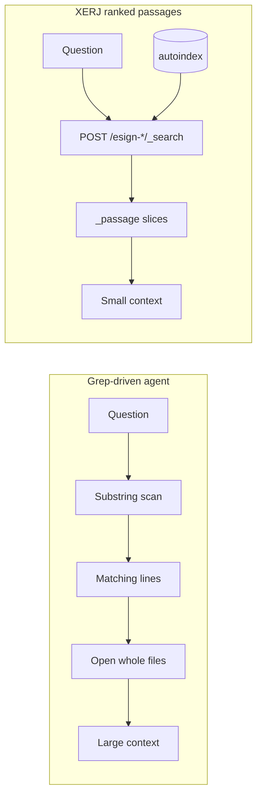
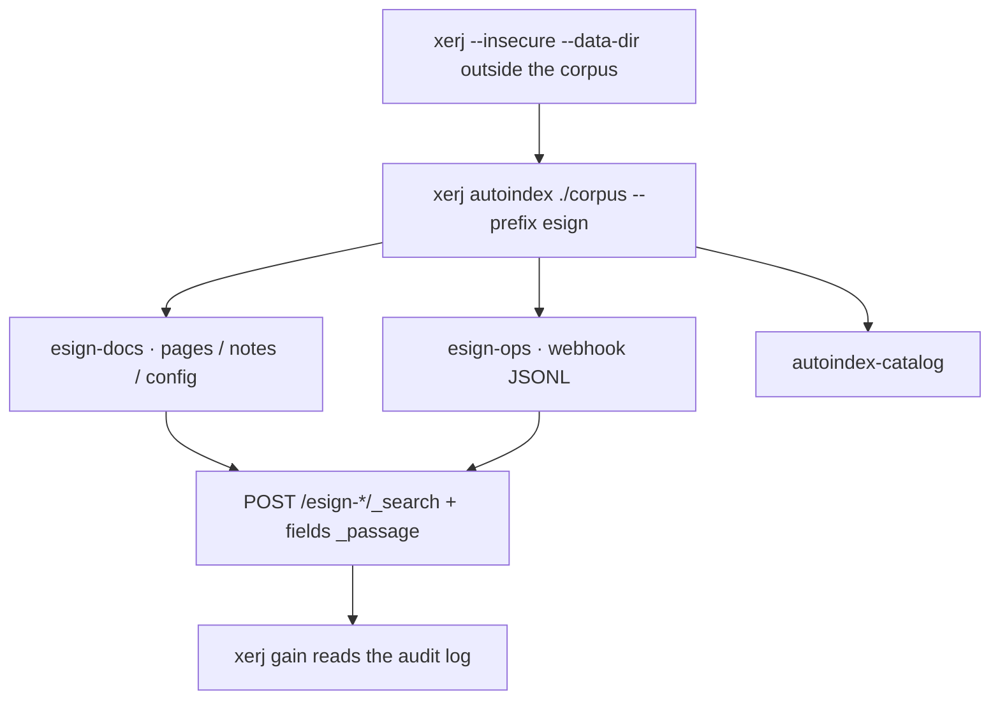

# How XERJ works (and what this demo captures)

Concept note for the Lumin Sign corpus desk. Not an API reference.

Upstream: **[xerj-org/xerj](https://github.com/xerj-org/xerj)** (Apache-2.0) — one static Rust binary. `xerj autoindex <folder>` turns mixed files (PDF, markdown, logs, JSONL, config) into typed Elasticsearch-compatible indices. Agents then query **ranked passages** instead of grepping and opening files.

Read [xerj.org/llms.txt](https://xerj.org/llms.txt) and the [CLI reference](https://xerj.org/docs/cli) before promising a feature. The trap the docs warn about: **the default embedder is lexical, not neural**.

## Why passages save tokens versus grep

XERJ’s README states the problem in one sentence: a grep hit is a line, and judging that line means opening the whole file. On one measured corpus a grep-driven agent pulled up to **1.06M input tokens**. Querying an index returns the matching passage (kilobytes).

This desk does **not** replay that coding-agent study. It only measures retrieval payload on our fixture:

| Arm | What we count as context |
| --- | --- |
| Grep | UTF-8 (or file) bytes of **every file that had a line hit** — the “open the file” cost XERJ describes |
| XERJ | UTF-8 bytes of the `_passage.text` values returned by `_search` |

Tokens shown in the UI are **bytes÷4**, labeled as estimates. `xerj gain` on this binary counts **searches / hit rate / latency**, not dollars.



## Indexing

`xerj autoindex` is **CLI-only** (no `POST /_autoindex`). It is a client of a node you already started. It sniffs files by magic bytes, infers datasets, writes explicit mappings, and streams records with idempotent ids.

This capture (`xerj` v1.0.0-rc.96, `--insecure`, prefix `esign`):

- 11 files → **2 datasets**: `esign-docs` (37 records: PDF pages, markdown, text, toml) and `esign-ops` (7 JSONL webhook events)
- PDFs become **one record per page** (`page`, `pdf_pages_total`, `body`)
- `body` / `text` are `semantic_text` (lexical embedder — offline, no key)
- Catalog lives in `autoindex-catalog`



Put `--data-dir` **outside** the folder you index. XERJ’s docs warn that `./data` inside the tree will be indexed too.

## Ranking passages

Documented query (from `xerj --help` and [llms.txt](https://xerj.org/llms.txt)):

```json
{
  "query": {
    "bool": {
      "should": [
        { "multi_match": { "query": "<question>", "fields": ["body", "title", "text"] } },
        { "match_phrase": { "body": { "query": "<question>", "boost": 2 } } }
      ]
    }
  },
  "_source": ["ax_path", "title", "page", "ax_format"],
  "fields": ["_passage"]
}
```

`_passage` is opt-in. Default `_search` returns whole stored documents. A passage object looks like `{field, ordinal, start_offset, end_offset, text, page?}`.

`xerj search "<q>"` is a **different** client: it builds a definition-first query on `defs` / `name` (code). On this docs corpus those fields do not exist, so the CLI returns **HTTP 400** under `strict_unknown_fields`. That failure is committed in `fixtures/xerj-search.json`. The UI uses the `_search` + `_passage` capture, which is the path XERJ documents for long documents.

A `_xerj.hints` entry on the BM25 capture suggested a `semantic` query on `body`. We ran it against `esign-docs`. With the default **lexical** embedder it ranked Harbor MSA signature pages above the countersign block. We did not swap the UI over to that ranking.

## MCP / skill wiring

One command, from XERJ’s own help:

```text
xerj init
```

Dry-run on this app folder (`fixtures/xerj-init-dry-run.txt`) said it would write:

- `.mcp.json` — register `xerj mcp` (stdio proxy to `XERJ_URL`, default `http://localhost:9200`)
- `.claude/skills/xerj/SKILL.md` — ~10 lines teaching `xerj search` / `xerj def`
- `.cursor/rules/xerj.mdc` when `.cursor/` exists
- a short `AGENTS.md` section

`xerj mcp` does **not** start a node. Start one first. Use an **absolute** binary path; desktop-launched hosts do not inherit `PATH`.

This demo does **not** run `xerj init` for real (it would add repo-root agent files we do not want). The dry-run text is the evidence.


Tools the binary advertises include `xerj_search`, `xerj_semantic_search`, `xerj_hybrid_search`, `xerj_map`, `xerj_plan` (`POST /_ask`), memory and brain tools, plus hub tools on newer builds. `xerj mcp --help` on rc.96 lists thirteen engine tools plus Corpus Hub tools.

## What this demo does not claim

- Not neural embeddings (no `--embed-mode neural`, no ~90 MB model download).
- Not Jev rerank (sends document text off-node; needs an operator key).
- Not XERJ’s 2.7× coding-agent output-token study. Those numbers stay in [their case study](https://xerj.org/case-studies/reference-coding.html).
- Not a production Lumin Sign integration.

## vs PageIndex on the long MSA

`apps/pageindex-contract-qa` (PR #12) walks a hierarchical TOC. This desk dumps the same *style* of Lumin Sign × Acme Holdings MSA into a **mixed** folder and asks for the liability cap. PageIndex’s strength is “which article would a lawyer open?”. XERJ’s strength is “which passage in this messy directory is most relevant?”. On that one question Harbor §8 outranked Acme 10.2.1. Both tools can be right for different jobs.

Run the app from [README.md](./README.md).
